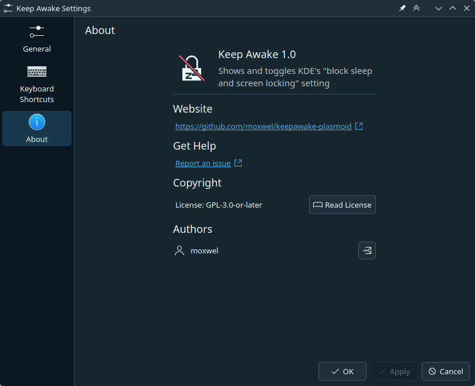
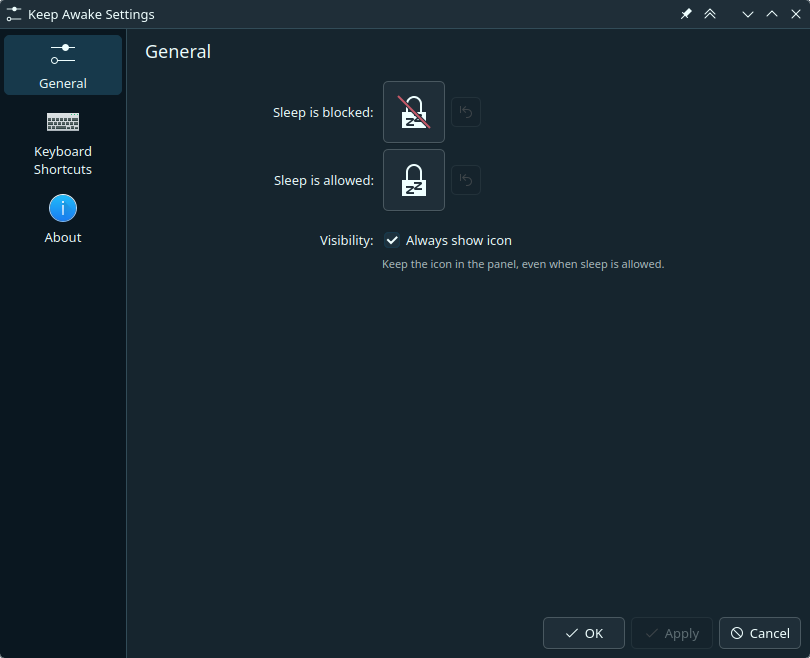

# Keep Awake Plasmoid

A simple KDE Plasma 6 panel widget that shows and toggles Plasma's own **"Manually block sleep and screen locking"** setting.

It hooks into Plasma's battery/brightness applet's `InhibitionControl` instead of holding its own lock, so both stay in sync.

> This is a learning project to help me learn more about KDE Plasma development, so I welcome any feedback or suggestions.

## Screenshots

### Usage


### Settings

<p>
  
  
</p>

## Install

### GitHub Releases

Download the [latest release](https://github.com/moxwel/keepawake-plasmoid/releases/latest/download/keepawake.plasmoid).

Install `keepawake.plasmoid` from *Add or Manage Widgets...* > *Get New* > *Install Widget From Local File...*.

Restart plasmashell or log out and back in if it does not appear immediately.

### Manual

```sh
./install.sh
```

Then right-click your panel > *Add or Manage Widgets...* > search for **Keep Awake** and drag it onto the panel.

Re-run `./install.sh` after editing any file; it rebuilds the package, upgrades it and reloads plasmashell in one step.

To uninstall:

```sh
./install.sh remove
```

## Build

```sh
./build.sh
```

Writes `build/keepawake.plasmoid`. Install it from *Add or Manage Widgets...* > *Get New* > *Install Widget From Local File...*.

> [!TIP]
> Bump `Version` in `metadata.json` before each release, otherwise Plasma does not offer the update.

## Settings

**Always show icon** is on by default. Turn it off and the widget leaves the panel entirely while the system is free to sleep, so it only shows up when something is being kept awake.

## Requirements

- Plasma 6 (developed and tested against 6.7.5)
- `kpackagetool6` (ships with KDE Frameworks 6)
- `gettext` to compile translations in `translate/` (`install.sh`, `build.sh`)
- `zip` (`install.sh`, `build.sh`)

> [!CAUTION]
> The widget reads and writes the inhibition through `InhibitionControl` from `org.kde.plasma.private.batterymonitor` QML module, the same type Plasma's own battery applet uses. That module ships with plasma-workspace on every Plasma 6 desktop, but it is a *private* module and carries no API stability guarantee, so a future Plasma release could require an update here.

## AI usage disclosure

I want to provide transparency and honesty about the use of AI in this project.

This project has been developed with the assistance of AI tools. AI was used to generate code snippets and documentation.

**ALL AI-generated content** has been **manually reviewed** and **edited by me (moxwel)**, to ensure code accuracy, readability, and quality with my personal standard coding practices.

## License

GPL-3.0-or-later. See [LICENSE](LICENSE).
